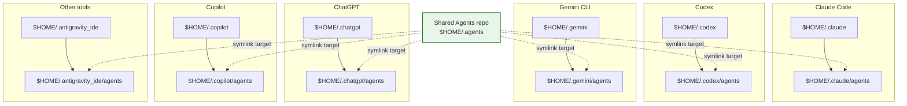

# Agents

 This repository stores my `$HOME/.agents` folder for AI agent use.

 The agent files should be kept in the repository's `.agents/` directory.

## Clone into `$HOME/.agents`

**Bash:**

```bash
# Optional: back up any existing ~/.agents directory
mv "$HOME/.agents" "$HOME/.agents.backup.$(date +%Y%m%d%H%M%S)"

# Clone this repository directly into ~/.agents
git clone -b main https://github.com/ByronScottJones/Agents.git "$HOME/.agents"
```

**PowerShell (Windows):**

```powershell
# Optional: back up any existing ~/.agents directory
if (Test-Path "$HOME\.agents") {
  $timestamp = Get-Date -Format "yyyyMMddHHmmss"
  Rename-Item -Path "$HOME\.agents" -NewName ".agents.backup.$timestamp"
}

# Clone this repository directly into ~/.agents
git clone -b main https://github.com/ByronScottJones/Agents.git "$HOME\.agents"
```

If you already cloned the repo elsewhere, you can link it instead:

**Bash:**

```bash
ln -s /path/to/Agents "$HOME/.agents"
```

**PowerShell (Windows):**

```powershell
# Create a symlink (requires admin or developer mode on Windows 10+)
New-Item -ItemType SymbolicLink -Path "$HOME\.agents" -Target "C:\path\to\Agents" -Force
```

## Link into AI coding tools

Many tools work best when they can see the repo contents through a stable path such as `$HOME/.agents` or a symlink to it.

### Recommended pattern



Example layout: each tool keeps its own home directory, and the `agents` subdirectory inside that tool points back to the shared `$HOME/.agents` repo.

Use a tool-specific parent directory for that tool's own files, then link the shared agent guidance into a common subdirectory such as `agents`. This lets each tool keep its own settings, cache, and history while reusing the same repository-backed instructions.

**Bash:**

```bash
#!/usr/bin/env bash

# Resolve shared Agents source directory:
# 1) Prefer ~/.agents if present
# 2) Otherwise prompt until a valid directory is entered
resolve_agents_src() {
  if [ -d "$HOME/.agents" ]; then
    printf '%s\n' "$HOME/.agents"
    return 0
  fi

  local input
  while :; do
    read -r -p "Enter the full path to your Agents repo: " input
    if [ -d "$input" ]; then
      printf '%s\n' "$input"
      return 0
    fi
    echo "Path does not exist or is not a directory: $input"
  done
}

# Create link only if missing; never replace existing paths
ensure_agents_link() {
  local parent_dir="$1"
  local link_path="$parent_dir/agents"
  local target="$2"

  mkdir -p "$parent_dir"
  if [ ! -e "$link_path" ]; then
    ln -s "$target" "$link_path"
    echo "Created: $link_path -> $target"
  else
    echo "Skipped (already exists): $link_path"
  fi
}

AGENTS_SRC="$(resolve_agents_src)"

ensure_agents_link "$HOME/.antigravity_ide"  "$AGENTS_SRC"
ensure_agents_link "$HOME/.chatgpt"  "$AGENTS_SRC"
ensure_agents_link "$HOME/.claude"  "$AGENTS_SRC"
ensure_agents_link "$HOME/.codex"   "$AGENTS_SRC"
ensure_agents_link "$HOME/.copilot" "$AGENTS_SRC"
ensure_agents_link "$HOME/.gemini"  "$AGENTS_SRC"
```

**PowerShell (Windows):**

```powershell
# Resolve shared Agents source directory:
# 1) Prefer $HOME\.agents if present
# 2) Otherwise prompt until a valid directory is entered
function Resolve-AgentsSource {
  $defaultPath = Join-Path $HOME ".agents"
  if (Test-Path $defaultPath -PathType Container) {
    return $defaultPath
  }

  do {
    $inputPath = Read-Host "Enter the full path to your Agents repo"
    if (-not (Test-Path $inputPath -PathType Container)) {
      Write-Host "Path does not exist or is not a directory: $inputPath"
    }
  } until (Test-Path $inputPath -PathType Container)

  return $inputPath
}

# Create link only if missing; never replace existing paths
function Ensure-AgentsLink {
  param(
    [Parameter(Mandatory = $true)][string]$ParentDir,
    [Parameter(Mandatory = $true)][string]$Target
  )

  if (-not (Test-Path $ParentDir -PathType Container)) {
    New-Item -ItemType Directory -Path $ParentDir | Out-Null
  }

  $linkPath = Join-Path $ParentDir "agents"
  if (-not (Test-Path $linkPath)) {
    New-Item -ItemType SymbolicLink -Path $linkPath -Target $Target | Out-Null
    Write-Host "Created: $linkPath -> $Target"
  }
  else {
    Write-Host "Skipped (already exists): $linkPath"
  }
}

$agentsSrc = Resolve-AgentsSource

$AgentDirNames = @(
    ".antigravity_ide",
    ".chatgpt",
    ".claude",
    ".codex",
    ".copilot",
    ".gemini"
)

foreach ($dirName in $AgentDirNames) {
    Ensure-AgentsLink -ParentDir (Join-Path $HOME $dirName) -Target $agentsSrc
}
```

---

### Grant default access so tools stop asking every time

The exact setting name varies by tool, but the goal is the same: set the workspace, instructions path, or trusted project root once so the tool can reuse it on future runs.

#### Claude Code

- Add the repository root or `.claude/agents` to Claude Code's trusted workspace/project list if it supports one.
- If Claude Code supports a default instructions or policy path, point it at `$HOME/.claude/agents/AGENTS.md` or the repo root.
- Keep the symlink in place so Claude can access the shared guidance without prompting for a new location each time.
- If Claude Code remembers approved directories, approve the parent directory that contains the `agents` link so the full path stays available.

#### Codex

- Configure Codex to open the repository root or the tool-specific parent directory that contains `agents`.
- If Codex supports a default workspace or trusted directory, set it once to the parent directory such as `$HOME/.codex`.
- If Codex supports a custom instructions file, point it at `$HOME/.codex/agents/AGENTS.md`.
- Approve or trust the parent directory so future sessions can reuse the same location without a new prompt.

#### Gemini CLI

- Start Gemini CLI from the repository root or from a directory that already has access to the `agents` symlink.
- If Gemini CLI supports a saved workspace or project directory, set it to `$HOME/.gemini` or the repo root once.
- If Gemini CLI supports default instruction files, point it at `$HOME/.gemini/agents/AGENTS.md`.
- Trust the parent directory so Gemini can reuse the shared guidance without asking again.

#### Other agent tools

- Look for a setting named workspace, project root, trusted directory, instructions path, or prompt file.
- Set it to the repo root or the tool-specific parent directory containing the `agents` symlink.
- If the tool supports persistent approvals, approve the parent directory rather than just a single file.
- If the tool supports startup arguments, pass the shared guidance path once and save that configuration for reuse.

## Guidance Layout

- `AGENTS.md` is always active and routes work to topic files.
- Load only the topic files that match the task; load multiple files when a task
  spans languages or frameworks.
- `CUA_TUI_Specification.md` applies only when CUA compliance is explicitly
  requested.

## Validation

**Bash:**

```bash
npx --yes markdownlint-cli2 '**/*.md' '#.git/**'
```

**PowerShell (Windows):**

```powershell
npx --yes markdownlint-cli2 '**/*.md' '#.git/**'
```

## Skills

Skills are on-demand workflows under `skills/<name>/SKILL.md`. Load a skill
when its trigger matches the task; topic files remain the source of policy and
the skill provides the execution workflow.

| Skill | Purpose |
| --- | --- |
| `get-pr-comments` | Retrieve pull request review feedback. |
| `address-pr-comments` | Implement and validate pull request feedback. |
| `remediate-dependency-vulnerabilities` | Scan and remediate vulnerable dependencies. |
| `validate-and-deploy-iac` | Validate, plan, and safely apply infrastructure as code. |
| `validate-github-actions` | Audit GitHub Actions syntax, permissions, and pinning. |
| `build-and-scan-container-image` | Build, scan, and generate SBOMs for images. |
| `validate-and-deploy-kubernetes` | Validate and safely deploy Kubernetes manifests. |
| `execute-database-migration` | Plan, test, and execute schema migrations. |
| `verify-service-health` | Verify deployment readiness and service health. |
| `generate-service-documentation` | Create service records and operational documentation. |
| `prepare-release` | Prepare release notes and promotion readiness. |
| `incident-triage` | Triage incidents using bounded operational evidence. |
| `validate-documentation` | Check Markdown, links, routing, and stale references. |
| `review-configuration` | Audit configuration safety and precedence. |
| `generate-adr` | Draft architecture decision records. |
